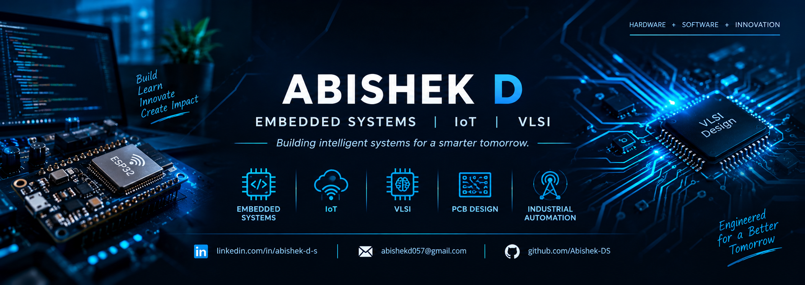

<!-- Profile README for https://github.com/Abishek-DS -->

  

  

  
  
  

---

## `01` &nbsp; About Me

Hey! I'm **Abishek D**, a final-year Electronics and Communication Engineering student at **Jansons Institute of Technology** and **Chief Technology Officer at Synaptronix Systems Pvt. Ltd.**

I enjoy bringing hardware and software together to build useful, connected systems—from microcontroller firmware and sensor integration to IoT monitoring and digital design.

- 🎓 **Education:** B.E. Electronics and Communication Engineering · 2023–2027
- ⚙️ **Role:** CTO · Synaptronix Systems Pvt. Ltd.
- 🔌 **Experience:** Embedded Systems & IoT Intern · Technologics Global Pvt. Ltd.
- 🏭 **Industry exposure:** NLC India Limited (NLCIL), Neyveli
- 🌱 **Currently exploring:** RTOS, digital logic, FPGA workflows and VLSI fundamentals

## `02` &nbsp; Technical Stack

  
  
  
  
  
  
  
  
  
  
  
  
  

| Embedded & IoT | Digital & Hardware | Tools |
|:--|:--|:--|
| Microcontroller firmware | Verilog HDL fundamentals | Git / GitHub |
| Sensor integration | Digital logic design | VS Code |
| Real-time systems concepts | PCB and circuit development | Keil / STM32Cube |
| Connected-device monitoring | FPGA learning workflows | Quartus / MATLAB basics |

## `03` &nbsp; Featured Projects

<table>
  <tr>
    <td width="50%" valign="top">
      <h3>🌱 AgriDry Pro</h3>
      
IoT-enabled smart crop-drying system focused on improving drying efficiency and quality.

      
<code>ESP32</code> <code>IoT</code> <code>Embedded C</code>

      
<a href="https://github.com/Abishek-DS/AgriDry-Pro">Explore repository →</a>

    </td>
    <td width="50%" valign="top">
      <h3>❤️ Med Track</h3>
      
RTOS-based health-monitoring concept with real-time alerts.

      
<code>FreeRTOS</code> <code>C</code> <code>IoT</code>

      
<a href="https://github.com/Abishek-DS/Med-Track">Explore repository →</a>

    </td>
  </tr>
  <tr>
    <td width="50%" valign="top">
      <h3>🛡️ SecureSense</h3>
      
IoT border-intrusion detection concept with instant alerts.

      
<code>ESP32</code> <code>Python</code> <code>IoT</code>

      
<a href="https://github.com/Abishek-DS/SecureSense">Explore repository →</a>

    </td>
    <td width="50%" valign="top">
      <h3>🏠 Smart Home Automation</h3>
      
Adaptive smart-curtain control based on ambient light conditions.

      
<code>ESP32</code> <code>C</code> <code>IoT</code>

      
<a href="https://github.com/Abishek-DS/Smart-Home-Automation">Explore repository →</a>

    </td>
  </tr>
  <tr>
    <td width="50%" valign="top">
      <h3>🌫️ Gas Detection & Monitoring</h3>
      
Multimodal gas-detection and monitoring concept with alerts.

      
<code>ESP32</code> <code>MQ-135</code> <code>IoT</code>

      
<a href="https://github.com/Abishek-DS/Gas-Detection-IoT">Explore repository →</a>

    </td>
    <td width="50%" valign="top">
      <h3>💧 Water Level Monitoring</h3>
      
A sensor-based project listed among my embedded-systems explorations.

      
<code>Sensors</code> <code>Embedded Systems</code>

      
<a href="https://github.com/Abishek-DS?tab=repositories">Browse repositories →</a>

    </td>
  </tr>
</table>

## `04` &nbsp; Experience

### Chief Technology Officer (CTO) · Synaptronix Systems Pvt. Ltd.
**2026 – Present**
- Contribute to technical planning, research and product development.
- Support embedded-system and IoT solution design.
- Collaborate with the engineering team on prototype development.

### Embedded Systems & IoT Intern · Technologics Global Pvt. Ltd., Bengaluru
**Jun 2026 – Jul 2026**
- Worked on Embedded C and microcontroller development.
- Explored sensor interfacing and IoT applications.
- Gained practical exposure to embedded-system development.

### Telecommunication & Communication Systems Trainee · NLC India Limited, Neyveli
**Jun 2025 – Jul 2025**
- Learned about industrial communication systems.
- Observed optical-fiber communication and SCADA concepts.
- Explored industrial networking and communication infrastructure.

## `05` &nbsp; GitHub Activity

  
  

  

## `06` &nbsp; Current Focus

- 🔧 Writing reliable embedded firmware and improving debugging practices
- 📡 Building connected IoT devices and sensor-driven prototypes
- 🧠 Strengthening digital logic, Verilog HDL and VLSI fundamentals
- ⚡ Learning RTOS concepts and FPGA design workflows
- 🚀 Turning prototypes into practical, well-documented projects

---

  <b>“Code • Design • Build • Innovate”</b> 
  Embedded Systems · IoT · VLSI · Digital Electronics  
  

